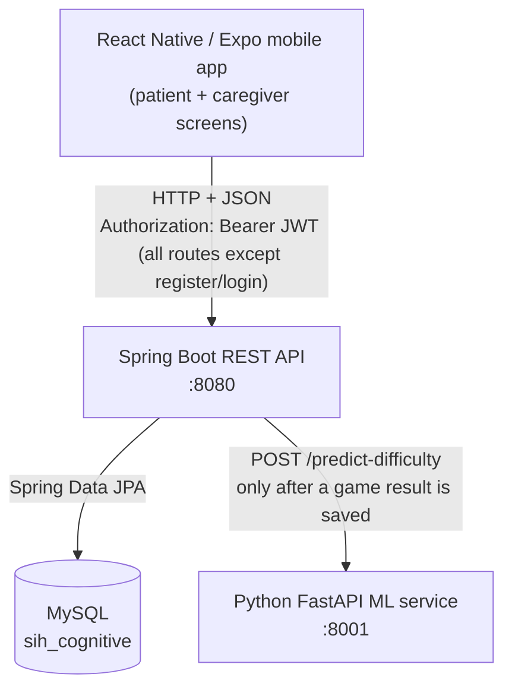

# Cognitive Gaming & Memory Assistance Platform

A mobile app and backend for older adults and people with memory or cognitive difficulties. Patients play short memory games, and their results are stored and summarised as progress metrics. Linked caregivers can review those metrics, and a separate machine-learning service recommends the next game difficulty.

The project started as a **Smart India Hackathon (SIH)** prototype. It is now being developed into a portfolio project focused on backend engineering: a layered Spring Boot REST API with JWT authentication, role- and relationship-based authorization, JPA persistence on MySQL, integration tests, and a fault-tolerant integration with a Python ML service.

> **Disclaimer:** This is a software prototype. It is **not** a medical device and is not clinically validated. It does not diagnose, treat, or prevent any cognitive condition. The difficulty model is trained on **synthetic data** only.

---

## Table of Contents

- [Project Status](#project-status)
- [Key Features](#key-features)
- [Technology Stack](#technology-stack)
- [System Architecture](#system-architecture)
- [Repository Structure](#repository-structure)
- [Prerequisites](#prerequisites)
- [Database Setup](#database-setup)
- [Backend Setup and Execution](#backend-setup-and-execution)
- [Machine-Learning Service Setup](#machine-learning-service-setup)
- [Mobile Application Setup](#mobile-application-setup)
- [Environment Variables](#environment-variables)
- [API Reference](#api-reference)
- [Adaptive Difficulty Flow](#adaptive-difficulty-flow)
- [Testing](#testing)
- [Example End-to-End Workflow](#example-end-to-end-workflow)
- [Troubleshooting](#troubleshooting)
- [Security Considerations](#security-considerations)
- [Limitations and Future Improvements](#limitations-and-future-improvements)
- [Screenshots and Demo](#screenshots-and-demo)
- [Contributing](#contributing)
- [License](#license)
- [Project Links](#project-links)

---

## Project Status

**Active development. Not production-ready.**

| Status | Scope |
|---|---|
| **Implemented in the backend, with integration tests** | Registration and login, JWT authentication, `/api/auth/me`, game-result submission and history, progress metrics, reminder create/list/complete, caregiver patient list, caregiver authorization, best-effort ML difficulty updates |
| **Implemented in the ML service, with API tests** | FastAPI `/predict-difficulty` and `/health`, RandomForest model that trains itself on synthetic data |
| **Implemented in the mobile app; end-to-end behaviour not formally tested** | Login and registration, Memory game with result submission, patient progress screen, caregiver dashboard and patient detail screens, language selection and voice-command groundwork |
| **Partially implemented or not connected** | Reminders (the backend API exists, but the mobile app has no reminder screen yet), the recommended difficulty (stored by the backend but not used by the Memory game), three of the four game tiles (only Memory has a screen), creating caregiver–patient links (no API) |
| **Planned** | See [Limitations and Future Improvements](#limitations-and-future-improvements) |

---

## Key Features

| # | Feature | What it does | Status |
|---|---|---|---|
| 1 | **Registration and login** | Users register with name, phone, password and role (`patient`, `caregiver`, `health_worker`). Each patient gets a generated ID such as `PT-000001`. Users log in with either their phone number or their patient ID. | Implemented (backend + mobile). The mobile app only offers the `patient` and `caregiver` roles. |
| 2 | **JWT authentication** | Login returns a signed HS256 JWT that contains the user ID and role. A stateless filter checks `Authorization: Bearer` headers. `GET /api/auth/me` returns the current user. | Implemented and tested. The mobile app stores the token in AsyncStorage. |
| 3 | **Game-result submission** | Patients submit `gameType`, `score`, `accuracy`, `reactionTime`, `mistakes` and `difficulty`. The backend validates the fields and saves them in `game_results`. | Implemented and tested. The Memory game calls this endpoint when a round ends. |
| 4 | **Cognitive game** | A Memory game with five levels (1–5). Each level sets how many objects are shown and how long the player can memorise them. | Memory game implemented. The `ATTENTION`, `PATTERN` and `ROUTINE` tiles are listed in the game selector but have no screens yet. |
| 5 | **Progress metrics** | Calculated from game results: `totalSessions`, `averageAccuracy`, `currentDifficulty`, `averageDifficulty` and a `recentPerformanceTrend` (`improving` / `declining` / `stable` / `insufficient_data`). | Implemented and tested. Shown on the patient Progress screen and the caregiver screens. |
| 6 | **Caregiver dashboard** | A caregiver sees their linked patients, sorted by `lastActive` (the time of the latest game result), and can open a patient's progress and game history. | Backend implemented and tested. Mobile screens call the real API. Caregiver–patient links must be created directly in the database (see [Database Setup](#linking-a-caregiver-to-a-patient-development-only)). |
| 7 | **Authorization** | Patients can access only their own data. Caregivers can access only linked patients. `health_worker` users have no patient-data access yet. Unknown patient IDs return `403`, not `404`, so the API does not reveal which IDs exist. | Implemented and tested. |
| 8 | **Reminders** | Patients create reminders (`medicine`, `hydration`, `activity`, `appointment`), list them in schedule order, and mark them complete. Completing a reminder twice has no extra effect. | Backend implemented and tested and **patient-only**. **Not connected in the mobile app.** The Reminders tile is a TODO, and the local-alarm helper (`scheduleReminderAlarm`) is not called anywhere yet. |
| 9 | **ML difficulty recommendation** | After a result is saved, the backend asks the ML service for a recommended difficulty and stores it in `users.current_difficulty`. | Implemented and tested with a mocked ML client. If the ML call fails, the difficulty is not updated, and the saved result is unaffected. The mobile game does **not** read the stored difficulty yet. |
| 10 | **Mobile ↔ backend integration** | The base URL comes from `EXPO_PUBLIC_API_BASE_URL`. The app calls login, register, `/me`, game results, progress and caregiver endpoints. | Implemented. No automated end-to-end tests. |

---

## Technology Stack

Versions come from `backend/pom.xml`, `mobile/package.json` and `ml/requirements.txt`.

| Layer | Technology | Purpose |
|---|---|---|
| Backend | **Java 17** (`java.version`) | Language level of the API |
| Backend | **Spring Boot 4.1.1** (`spring-boot-starter-parent`) | Application framework and dependency management |
| Backend | **Maven** (wrapper `mvnw` / `mvnw.cmd`, Maven 3.9.16) | Build, test and run, with no global Maven install needed |
| Backend | Spring Web MVC (`spring-boot-starter-webmvc`) | REST controllers |
| Backend | Spring Data JPA / Hibernate | Entity mapping and repositories |
| Backend | Spring Security | Stateless security filter chain and role-based route rules |
| Backend | JJWT 0.12.6 | Signing and checking HS256 JWTs |
| Backend | BCrypt (`BCryptPasswordEncoder`) | Password hashing |
| Backend | Jakarta Bean Validation | Validating request DTOs |
| Backend | `RestClient` | HTTP calls to the ML service, with connect and read timeouts |
| Database | **MySQL** (`mysql-connector-j`) | Stores users, game results, reminders and caregiver links |
| Backend tests | JUnit 5, Spring MockMvc, Spring Security Test, Mockito | Integration and unit tests |
| Mobile | **React Native 0.86** + **Expo SDK 57** + **TypeScript** | Cross-platform patient and caregiver app |
| Mobile | React Navigation (native stack) | Screen navigation |
| Mobile | AsyncStorage | Keeps the JWT on the device |
| Mobile | Notifee | Local alarm notification channel and scheduling helper |
| Mobile | i18next / react-i18next | UI translations (English, Hindi, Bengali, Assamese) |
| Mobile | expo-speech, expo-speech-recognition | Text-to-speech and voice-command groundwork |
| Mobile | expo-dev-client, EAS (`eas.json`) | Development builds, needed because of native modules |
| ML | **Python** + **FastAPI** + Uvicorn + Pydantic | Difficulty prediction HTTP service |
| ML | **scikit-learn** `RandomForestClassifier`, pandas, NumPy, joblib | Model training, inference and saving the model file |
| ML tests | pytest + httpx | API tests through FastAPI's `TestClient` |

The repository has no Docker, CI/CD pipeline, cache or cloud deployment configuration.

---

## System Architecture



| Component | Responsibilities |
|---|---|
| **Mobile app** (`mobile/`) | UI for patients and caregivers, the Memory game, storing the JWT, calling the REST API. It never talks to the ML service directly. |
| **Spring Boot API** (`backend/`) | Authentication, JWT issuing and checking, validation, authorization (role rules plus ownership and caregiver-link checks), persistence, progress calculation, ML integration. |
| **MySQL** | Tables `users`, `game_results`, `reminders` and `caregiver_patients`, all created and updated by Hibernate. |
| **ML service** (`ml/`) | A stateless difficulty recommender. It receives one session's performance plus the patient's current difficulty and returns a value from 1 to 5. |

The ML service is only called from `POST /api/game-results`. No other request goes through it. The call runs inside that request after the result is saved. Any failure (service down, timeout, error response, out-of-range value) is logged and ignored, so the client still gets `201 Created`. See [Adaptive Difficulty Flow](#adaptive-difficulty-flow).

### Backend layering

```text
controller → service → repository → entity
    ↑            ↑
   dto      client/MlDifficultyClient
security/ (JWT filter, entry point, access-denied handler)
exception/ (GlobalExceptionHandler → {"message": "..."} error bodies)
```

---

## Repository Structure

```text
SIH-Cognitive-Assistant/
├── backend/                         # Spring Boot REST API
│   ├── pom.xml
│   ├── mvnw, mvnw.cmd               # Maven wrapper
│   ├── .env.example                 # Variable-name reference (not auto-loaded)
│   ├── AUTH_API.md                  # Detailed authentication API docs
│   └── src/
│       ├── main/java/com/sih/backend/
│       │   ├── client/              # MlDifficultyClient (calls the ML service)
│       │   ├── config/              # SecurityConfig
│       │   ├── controller/          # Auth, GameResult, Progress, Reminder, Caregiver
│       │   ├── dto/                 # Request/response objects
│       │   ├── entity/              # User, GameResult, Reminder, CaregiverPatient, enums
│       │   ├── exception/           # Custom exceptions + GlobalExceptionHandler
│       │   ├── repository/          # Spring Data JPA repositories
│       │   ├── security/            # JwtService, JwtAuthenticationFilter, handlers
│       │   └── service/             # Business logic and authorization
│       ├── main/resources/application.properties
│       └── test/                    # Integration + unit tests, test properties
├── ml/                              # FastAPI difficulty prediction service
│   ├── app/                         # main.py, schemas.py, model_service.py
│   ├── training/                    # generate_data.py, train_model.py
│   ├── tests/test_api.py
│   ├── requirements.txt
│   └── README.md
├── mobile/                          # React Native / Expo app
│   ├── App.tsx                      # Navigation stack and auth state
│   ├── app.json, eas.json
│   ├── .env.example                 # EXPO_PUBLIC_API_BASE_URL template
│   └── src/
│       ├── api/                     # config.ts, auth.ts, gameResults.ts
│       ├── screens/                 # Login, Register, Home, Memory, Progress, Caregiver*, …
│       ├── notifications/           # Notifee alarm channel and scheduling helper
│       ├── i18n/                    # i18next setup and locale JSON files
│       ├── voice/                   # TTS and voice-command matching
│       └── components/
├── docs/
│   └── API_CONTRACT.md              # Game result, progress, reminder and caregiver API contract
├── LICENSE
└── README.md
```

---

## Prerequisites

### Backend only

| Requirement | Notes |
|---|---|
| **JDK 17 or newer** | `pom.xml` targets Java 17. `JAVA_HOME` must point to the JDK. |
| **Maven** | Optional. The wrapper (`mvnw.cmd`) downloads Maven 3.9.16 on first use, which needs internet access. |
| **MySQL Server** | Reachable at `127.0.0.1:3306`, which is hard-coded in `application.properties`. The project does not specify a MySQL version. MySQL 8 is a sensible choice but has not been formally tested. |

### Full application (adds)

| Requirement | Notes |
|---|---|
| **Python 3** with `pip` and `venv` | No Python version is pinned in the repository. The code uses Pydantic v2 and FastAPI's `lifespan` API, so use a current Python 3 release. |
| **Node.js + npm** | Use a Node.js LTS release that Expo SDK 57 supports. See the [Expo SDK 57 docs](https://docs.expo.dev/versions/v57.0.0/). |
| **Android Studio + Android SDK** (or an EAS account) | The app uses native modules (Notifee, expo-speech-recognition) and `expo-dev-client`, so it needs a **development build**. It cannot run in Expo Go. |
| Android emulator or physical Android device | iOS scripts exist but iOS has not been documented or verified for this project. |

---

## Database Setup

1. Create the database (the name is fixed in `spring.datasource.url`):

   ```sql
   CREATE DATABASE sih_cognitive;
   ```

2. Pass the credentials to the backend through environment variables (see [Environment Variables](#environment-variables)):
   - `DB_USERNAME` (defaults to `root`)
   - `DB_PASSWORD` (required, with no default)

3. **No manual schema setup is needed.** `application.properties` sets:

   ```properties
   spring.jpa.hibernate.ddl-auto=update
   spring.jpa.show-sql=true
   ```

   Hibernate creates and updates tables from the JPA entities when the app starts. This is convenient for development, but it **does not replace a proper migration tool** such as Flyway or Liquibase for production. It never drops columns and can drift from what you expect. `show-sql=true` also writes every SQL statement to the console.

> **Note:** `backend/src/test/resources/application.properties` points at the **same** `sih_cognitive` database. Tests are `@Transactional` and roll back their changes, but they still need a running MySQL and `DB_PASSWORD`.

### Linking a caregiver to a patient (development only)

There is **no API** for creating caregiver–patient links. `CaregiverPatient` rows are created outside the API, in tests or directly in the database. To try the caregiver dashboard locally, register a caregiver and a patient, then insert a link:

```sql
INSERT INTO caregiver_patients (caregiver_id, patient_id, created_at)
SELECT c.id, p.id, NOW()
FROM users c, users p
WHERE c.phone = '<caregiver-phone>'
  AND p.patient_id = '<patient-id, e.g. PT-000001>';
```

The `(caregiver_id, patient_id)` pair has a unique constraint.

---

## Backend Setup and Execution

All commands are for **Windows PowerShell**. Set the environment variables in the same terminal session that starts the backend.

```powershell
# 1. Go to the backend
cd backend

# 2. Configure required environment variables (this session only)
$env:DB_USERNAME = "root"
$env:DB_PASSWORD = "<your-local-mysql-password>"
$env:JWT_SECRET  = "<replace-with-a-strong-secret-at-least-32-characters>"

# Optional (defaults shown in the Environment Variables table)
# $env:ML_SERVICE_URL = "http://localhost:8001"
```

To generate a suitable random `JWT_SECRET` in PowerShell:

```powershell
$bytes = New-Object byte[] 48
[System.Security.Cryptography.RandomNumberGenerator]::Create().GetBytes($bytes)
[Convert]::ToBase64String($bytes)
```

```powershell
# 3. Build and run the tests (needs MySQL running and DB_PASSWORD set)
.\mvnw.cmd test

# 4. Start the API
.\mvnw.cmd spring-boot:run
```

- **Base URL:** `http://localhost:8080`. No `server.port` is set, so Spring Boot uses its default port.
- **Stop:** press `Ctrl+C` in the terminal running the app.
- `backend/.env.example` only **lists the variable names**. Spring Boot does **not** load `.env` files, and no dotenv loader is configured. Set the values as real environment variables in your shell or in your IDE's run configuration (in IntelliJ: *Run/Debug Configurations → Environment variables*).
- The backend starts without the ML service. Difficulty updates are skipped until the ML service is reachable.

See [`backend/AUTH_API.md`](backend/AUTH_API.md) for more detail on authentication setup.

---

## Machine-Learning Service Setup

The service in [`ml/`](ml/) recommends a difficulty level (1–5) from one game session's performance. It uses a scikit-learn `RandomForestClassifier` (200 trees, max depth 8) trained on a **synthetic** dataset of 6,000 rows produced by `training/generate_data.py`.

```powershell
cd ml

# Create and activate a virtual environment
python -m venv .venv
.\.venv\Scripts\Activate.ps1

# Install dependencies (requirements.txt has no version pins)
pip install -r requirements.txt

# Start the service on the port the backend expects
python -m uvicorn app.main:app --reload --port 8001
```

- **URL:** `http://localhost:8001`
- **Model initialisation:** you do not need to train first. On startup, if `ml/models/difficulty_model.joblib` is missing, the service trains and saves the model, which takes a few seconds. To retrain manually, run `python -m training.train_model` from `ml/`. The model file and `models/` are git-ignored.
- **Health check:** `GET http://localhost:8001/health` returns `{"status": "ok", "model_loaded": true}`.
- **Backend connection:** the backend reads `ML_SERVICE_URL` (property `ml.service.url`, default `http://localhost:8001`) and calls `POST {ML_SERVICE_URL}/predict-difficulty`.
- **Stop:** `Ctrl+C`. Run `deactivate` to leave the virtual environment.

### `POST /predict-difficulty`

```json
{
  "gameType": "memory",
  "score": 8,
  "accuracy": 0.8,
  "reactionTime": 1200,
  "mistakes": 2,
  "currentDifficulty": 2
}
```

```json
{ "recommendedDifficulty": 3 }
```

Validation rules: `gameType` must be `"memory"` (the only type supported), `score ≥ 0`, `0.0 ≤ accuracy ≤ 1.0`, `reactionTime ≥ 0` (milliseconds), `mistakes ≥ 0`, `1 ≤ currentDifficulty ≤ 5`. Invalid input returns FastAPI's standard `422`. The output is always limited to the range 1–5. See [`ml/README.md`](ml/README.md).

---

## Mobile Application Setup

### 1. Install dependencies

```powershell
cd mobile
npm install
```

### 2. Configure the backend URL

The app reads `EXPO_PUBLIC_API_BASE_URL` in [`mobile/src/api/config.ts`](mobile/src/api/config.ts). If it is not set, it falls back to `http://localhost:8080`. Copy the template and edit it:

```powershell
Copy-Item .env.example .env
```

```dotenv
EXPO_PUBLIC_API_BASE_URL=http://<host-address>:8080
```

`mobile/.env` is git-ignored. Expo inlines `EXPO_PUBLIC_*` values when it bundles the app, so **restart the Expo dev server after changing the value**.

Choosing `<host-address>`:

| Where the app runs | Value to use | Why |
|---|---|---|
| Android **emulator** | `http://10.0.2.2:8080` | Inside the emulator, `localhost` means the emulator itself. `10.0.2.2` is its alias for your computer. |
| **Physical** Android device on the same Wi-Fi | `http://<your-computer-LAN-IPv4>:8080` | `localhost` would point at the phone. Find your IPv4 address with `ipconfig` (look under your active Wi-Fi/Ethernet adapter). It can change when you switch networks. |
| Physical device over USB (alternative) | `http://localhost:8080` after running `adb reverse tcp:8080 tcp:8080` | Forwards the device's port 8080 to your computer. |

If you use a physical device over Wi-Fi, Windows Defender Firewall must allow inbound connections to port 8080 on that network.

### 3. Build and run on Android

The app depends on native modules (`@notifee/react-native`, `expo-speech-recognition`) and `expo-dev-client`, so **Expo Go is not supported**. Use a development build:

```powershell
# Generates the native android/ project (git-ignored), builds, and installs the app
npm run android        # = expo run:android
```

This needs Android Studio, the Android SDK and a JDK. Once the development build is installed, you can start just the bundler with:

```powershell
npm start              # = expo start
```

You can also build a development client in the cloud with EAS using the `development` profile in `eas.json`. This requires an Expo account.

---

## Environment Variables

| Variable | Component | Purpose | Example placeholder | Required |
|---|---|---|---|---|
| `DB_USERNAME` | Backend | MySQL username | `root` | No (default `root`) |
| `DB_PASSWORD` | Backend (app **and** tests) | MySQL password | `<your-local-mysql-password>` | **Yes** |
| `JWT_SECRET` | Backend | HMAC key for signing JWTs. Must be at least 32 bytes, or JJWT rejects it. | `<replace-with-a-strong-secret>` | **Yes** (for running the app; tests use a test-only key in `src/test/resources`) |
| `JWT_EXPIRATION_MS` | Backend | Token lifetime | `86400000` (24 h) | No |
| `ML_SERVICE_URL` | Backend | Base URL of the ML service | `http://localhost:8001` | No (default shown) |
| `ML_SERVICE_CONNECT_TIMEOUT_MS` | Backend | ML connect timeout | `3000` | No |
| `ML_SERVICE_READ_TIMEOUT_MS` | Backend | ML read timeout | `3000` | No |
| `EXPO_PUBLIC_API_BASE_URL` | Mobile | Backend base URL used by the app | `http://<host-address>:8080` | Recommended (default `http://localhost:8080`, which only suits the iOS simulator or `adb reverse` setups) |

The ML service reads no environment variables.

**Never commit secrets.** `.env` and `.env*.local` are git-ignored at the root and in `mobile/`. The tracked `*.env.example` files must stay free of real values. `EXPO_PUBLIC_*` values are built into the app bundle, so never put secrets in them.

---

## API Reference

Base URL: `http://localhost:8080`. All bodies are JSON. Timestamps are ISO-8601 `LocalDateTime` values without a timezone, for example `2026-09-08T10:00:00`.

After logging in, send the token on every protected request:

```http
Authorization: Bearer <your-jwt-token>
```

| Method | Endpoint | Auth | Access rule | Purpose |
|---|---|---|---|---|
| POST | `/api/auth/register` | Public | — | Register a user |
| POST | `/api/auth/login` | Public | — | Log in with phone or patient ID and receive a JWT |
| GET | `/api/auth/me` | JWT | Any role | Current user's `userId`, `role` and (for patients) `patientId` |
| POST | `/api/game-results` | JWT | `PATIENT` only (route rule) | Submit a result for the authenticated patient |
| GET | `/api/game-results/patient/{patientId}` | JWT | The patient themselves, or a linked caregiver | Game history, newest first |
| GET | `/api/progress/patient/{patientId}` | JWT | The patient themselves, or a linked caregiver | Progress metrics |
| GET | `/api/caregiver/patients` | JWT | `CAREGIVER` only (route rule) | Linked patients with `lastActive` |
| POST | `/api/reminders` | JWT | The patient themselves only | Create a reminder |
| GET | `/api/reminders/patient/{patientId}` | JWT | The patient themselves only | Reminders, sorted by `scheduledAt` ascending |
| PATCH | `/api/reminders/{id}/complete` | JWT | The owning patient only | Mark a reminder complete (repeat calls have no extra effect) |

**Error format:** `{"message": "..."}`. Common statuses: `400` (validation, malformed body, duplicate phone, invalid role or reminder type), `401` (`"Invalid or missing token"` or `"Invalid credentials"`), `403` (wrong role, not the owner, not linked, or unknown `patientId`), `404` (reminder not found), `500` (`"Something went wrong"`). Validation errors return only the **first** failing field's message.

Full details: [`backend/AUTH_API.md`](backend/AUTH_API.md) (auth) and [`docs/API_CONTRACT.md`](docs/API_CONTRACT.md) (game results, progress, reminders, caregiver).

### Register — `POST /api/auth/register` → `201`

```json
{ "name": "<name>", "phone": "<phone>", "password": "<min-6-chars>", "role": "patient" }
```

```json
{ "message": "Registration successful", "role": "patient", "patientId": "PT-000001" }
```

`role` is case-insensitive: `patient`, `caregiver` or `health_worker`. `patientId` is generated only for patients and left out of the response for other roles. The password must be at least 6 characters, and the phone number must be unique.

### Login — `POST /api/auth/login` → `200`

```json
{ "identifier": "<phone-or-patientId>", "password": "<password>" }
```

Returns a **JSON object**, not a raw token string:

```json
{ "token": "<jwt>", "role": "patient", "userId": 1 }
```

### Current user — `GET /api/auth/me` → `200`

```json
{ "userId": 1, "role": "patient", "patientId": "PT-000001" }
```

`patientId` is included only for patient accounts.

### Submit a game result — `POST /api/game-results` → `201`

```json
{ "gameType": "memory", "score": 4, "accuracy": 0.8, "reactionTime": 1500, "mistakes": 1, "difficulty": 2 }
```

```json
{
  "id": 10, "gameType": "memory", "score": 4, "accuracy": 0.8, "reactionTime": 1500,
  "mistakes": 1, "difficulty": 2, "patientId": "PT-000001", "createdAt": "2026-09-08T10:00:00"
}
```

All fields are required. `accuracy` must be in `[0.0, 1.0]`. `score`, `reactionTime`, `mistakes` and `difficulty` must be at least 0. The patient is taken from the JWT, not from the request body.

### Progress — `GET /api/progress/patient/{patientId}` → `200`

```json
{
  "patientId": "PT-000001", "totalSessions": 6, "averageAccuracy": 0.72,
  "currentDifficulty": 3, "averageDifficulty": 2.5, "recentPerformanceTrend": "improving"
}
```

`recentPerformanceTrend` needs at least 3 sessions. It compares the average accuracy of the newer half of results with the older half: a difference above `0.05` is `improving`, below `-0.05` is `declining`, and anything in between is `stable`. With no results, `totalSessions` is `0` and `averageDifficulty` is `null`.

### Create a reminder — `POST /api/reminders` → `201`

```json
{ "patientId": "PT-000001", "type": "medicine", "title": "<title>", "scheduledAt": "2026-09-08T09:00:00" }
```

```json
{
  "id": 1, "patientId": "PT-000001", "type": "medicine", "title": "<title>",
  "scheduledAt": "2026-09-08T09:00:00", "completed": false,
  "createdAt": "2026-09-07T18:00:00", "completedAt": null
}
```

`type` is case-insensitive and must be one of `medicine`, `hydration`, `activity` or `appointment`.

---

## Adaptive Difficulty Flow

1. The patient finishes a Memory game round. The **level they chose** (1–5) is the completed session's difficulty.
2. The mobile app calls `POST /api/game-results` with that `difficulty` and the round's metrics.
3. The backend validates the request and **saves the `GameResult` first**.
4. `GameResultService` then calls the ML service through `MlDifficultyClient`. It sends the session metrics plus the patient's **stored `currentDifficulty`**, not the difficulty of the session just played.
5. If the ML service returns a value from 1 to 5, the backend saves it as `users.current_difficulty`, which starts at 1 for new users. A `null` value, an out-of-range value, a timeout, a connection error, an error status, or a `422` (for example a `gameType` other than `memory`) is logged and ignored. The stored difficulty stays the same.
6. The client gets `201` with the saved result either way. The new recommendation is visible as `currentDifficulty` in `GET /api/progress/patient/{patientId}`.

**Two separate values:**

- `GameResult.difficulty` is the difficulty the session was **actually played at**. The client sends it, and it is used for `averageDifficulty`.
- `User.currentDifficulty` is the **recommended difficulty for future sessions**. It is updated only by the ML service.

**Current gap:** the mobile Memory game does not read `currentDifficulty`. It starts at level 2 and the player picks the level by hand. The recommendation is stored and displayed but not yet applied to gameplay.

The ML call runs synchronously within the request, so a slow ML service can add up to the configured connect and read timeouts (3 s each by default) to the submission.

---

## Testing

The tests have not been run as part of writing this README, so no pass count is reported here. To run them:

### Backend

```powershell
cd backend
$env:DB_PASSWORD = "<your-local-mysql-password>"
.\mvnw.cmd test
```

This needs a running local MySQL with the `sih_cognitive` database. `JWT_SECRET` is not needed because the test properties contain a test-only key. The ML service does not need to be running.

| Test class | Covers |
|---|---|
| `AuthIntegrationTest` | Register, login by phone or patient ID, `/me`, invalid credentials and tokens |
| `GameResultIntegrationTest` | Submission, validation, role restriction, result history access |
| `GameResultMlIntegrationTest` | ML recommendation saved; ML failure, `null` or out-of-range values ignored without affecting the saved result (ML client mocked with `@MockitoBean`) |
| `ProgressIntegrationTest` | Metrics and trend calculation, insufficient data, access rules |
| `ReminderIntegrationTest` | Create, list, complete (repeat-safe), type validation, ownership |
| `CaregiverAuthorizationIntegrationTest` | Caregiver patient list and ordering, linked vs unlinked access, health-worker denial |
| `JwtServiceTest`, `PasswordEncoderTest` | Token generation and validation; BCrypt hashing |
| `BackendApplicationTests` | Spring context loads |

### ML service

```powershell
cd ml
.\.venv\Scripts\Activate.ps1
pytest
```

`tests/test_api.py` covers `/health`, the shape of a valid prediction, rejection of invalid input, boundary difficulties, and the 1–5 output range. The first run may train the model.

### Mobile

`package.json` has **no test or lint scripts**, and the mobile app has no automated tests. You can run these optional static checks:

```powershell
cd mobile
npx tsc --noEmit      # TypeScript type check (typescript is a devDependency)
npx expo-doctor       # Expo project health check
```

There are no automated end-to-end tests across mobile, backend and ML.

---

## Example End-to-End Workflow

### Patient

1. **Register** in the app as a patient. The backend returns a `patientId`, and the app logs in automatically and stores the JWT. *(Implemented)*
2. The app calls `/api/auth/me` to learn the patient's own `patientId`. *(Implemented)*
3. Choose **Play Game → Memory**, pick a level, and play a round. *(Implemented)*
4. The app submits the result to `POST /api/game-results`. The backend saves it and asks the ML service for a new recommended difficulty. *(Implemented. The ML step is best-effort.)*
5. Open **My Progress** to see the total sessions, average accuracy, current recommended difficulty and trend. *(Implemented)*
6. The recommended difficulty appears on the progress screen but is **not** applied to the next game automatically. *(Not connected)*
7. Reminders can be created, listed and completed **through the REST API only**. The app's Reminders tile does not do anything yet. *(Backend only)*

### Caregiver

1. Register in the app as a caregiver. After login, the app opens the Caregiver Dashboard. *(Implemented)*
2. Link the caregiver to a patient in MySQL (see [Linking a caregiver to a patient](#linking-a-caregiver-to-a-patient-development-only)). *(No API or UI for this)*
3. The dashboard lists linked patients with their last activity and progress. Selecting a patient shows their progress and game history. *(Implemented)*

Each layer has been tested on its own (backend integration tests, ML API tests). The full mobile → backend → ML flow has **not** been covered by automated tests.

---

## Troubleshooting

| Symptom | Likely cause / fix |
|---|---|
| `Access denied for user` / `Communications link failure` on startup | MySQL is not running on `127.0.0.1:3306`, `sih_cognitive` does not exist, or `DB_USERNAME`/`DB_PASSWORD` are wrong or missing in **this** terminal session. |
| `Could not resolve placeholder 'JWT_SECRET'` | `JWT_SECRET` is not set in the session that runs `mvnw.cmd`. |
| `WeakKeyException` / key is not secure enough | `JWT_SECRET` is shorter than 32 bytes. Use a longer value. |
| `401 {"message":"Invalid or missing token"}` | Missing or malformed `Authorization: Bearer` header, or the token expired (24 h by default). Tokens signed with a different `JWT_SECRET` are also rejected, including all old tokens after you change the secret. |
| `403` when submitting a game result | Only `PATIENT` accounts may `POST /api/game-results`. |
| `403` on progress or results for a caregiver | No `caregiver_patients` row links that caregiver to the patient. |
| Port 8080 already in use | Stop the other process, or start the backend on another port with `.\mvnw.cmd spring-boot:run "-Dspring-boot.run.arguments=--server.port=8081"` and update `EXPO_PUBLIC_API_BASE_URL` to match. |
| `currentDifficulty` never changes | The ML service is not running on `ML_SERVICE_URL`. Check `http://localhost:8001/health` and look for `ML difficulty prediction call failed` warnings in the backend log. Only `gameType: "memory"` is accepted by the model. |
| `ModuleNotFoundError` in `ml/` | The virtual environment is not active, or `pip install -r requirements.txt` was not run. Start Uvicorn from inside `ml/` so `app` and `training` can be imported. |
| Mobile shows network request failed | Wrong `EXPO_PUBLIC_API_BASE_URL` (see the table in [Mobile Application Setup](#mobile-application-setup)), dev server not restarted after editing `.env`, phone and PC on different networks, or Windows Firewall blocking port 8080. |
| Physical device can't reach `localhost:8080` | On a phone, `localhost` is the phone itself. Use your computer's LAN IPv4 address or `adb reverse tcp:8080 tcp:8080`. |
| App crashes or modules missing in Expo Go | Native modules need a development build. Use `npm run android` instead of Expo Go. |
| `npm run android` fails | Check that Android Studio, the SDK, `ANDROID_HOME` and a JDK are installed and that an emulator or device shows in `adb devices`. Running `npx expo-doctor` can point out dependency version mismatches. |

---

## Security Considerations

**What is in place:**

- Passwords are hashed with BCrypt and never returned in responses.
- Stateless HS256 JWTs carry the user ID and role. The signing key comes from the environment and is not committed (the test key is clearly marked test-only).
- Spring Security has CSRF, HTTP Basic and form login disabled, uses stateless sessions, and returns JSON `401`/`403` responses.
- Route-level role rules: patient-only result submission and a caregiver-only patient list.
- Service-level ownership and caregiver-link checks on all patient-data endpoints. Unknown patient IDs return `403`, so the API does not reveal which IDs exist.
- Login returns the same error for an unknown user and a wrong password.
- Request DTOs are validated with Bean Validation.

**Limitations to address before any deployment:**

- Local secrets must never be committed. The development configuration is not production configuration (`ddl-auto=update`, `show-sql=true`, plain HTTP, hard-coded DB host).
- There are no refresh tokens, token revocation, rate limiting or account lockout. The minimum password length is 6.
- `health_worker` accounts can register but have no defined data-access model.
- The mobile app stores the JWT in AsyncStorage, which is not encrypted secure storage.
- No CORS, HTTPS or security-header configuration exists for a deployed environment.
- The access-control rules have integration tests, but they have not been independently reviewed or penetration-tested.

---

## Limitations and Future Improvements

**Unfinished work in the current codebase:**

- Connect reminders in the mobile app: a reminder screen, API client, and Notifee alarm scheduling. The helper exists but is unused.
- Apply the stored `currentDifficulty` to the Memory game's starting level.
- Add an API and UI for creating and removing caregiver–patient links.
- Build the `ATTENTION`, `PATTERN` and `ROUTINE` games listed in the game selector.
- Define what `health_worker` users can access.
- Connect recognised voice commands to real actions. They are currently only logged.
- Small inconsistencies between docs and code:
  - The `/me` example in `backend/AUTH_API.md` leaves out `patientId`, which the API returns for patients.
  - The mobile `ProgressResponse` type treats `averageDifficulty` as always a number, but the API returns `null` when there are no results.

**Engineering improvements:**

- Use a dedicated test database or Testcontainers instead of the development database.
- Use a migration tool (Flyway or Liquibase) instead of `ddl-auto=update`.
- Make the database host and port configurable, add production profiles, and document a deployment.
- Add CI to run `mvnw test` and `pytest` on every pull request.
- Pin Python dependency versions and set a supported Python version.
- Add automated end-to-end and mobile tests, and return more detailed validation errors (all failing fields).
- Collect real, consented usage data before relying on the difficulty model, and evaluate it properly. It is currently trained only on synthetic data.

---

## Screenshots and Demo

> **TODO:** Add screenshots of the login, Memory game, progress and caregiver dashboard screens, and optionally a short demo video, once they have been captured from a running build. For example, put them in `docs/screenshots/` and reference them here with relative paths.

There is no hosted deployment or public demo.

---

## Contributing

1. Create a feature branch from `main`, for example `feature/<issue-number>-<short-name>`.
2. Keep changes focused. Add or update tests for backend (`mvnw test`) and ML (`pytest`) changes.
3. Never commit secrets, `.env` files, or generated model artifacts.
4. Open a pull request against `main` that describes the change and how you verified it.

---

## License

The repository contains a [`LICENSE`](LICENSE) file. It is the **MIT License text with the copyright line "650 Industries, Inc. (aka Expo)"**, which appears to have been carried over from the Expo project template. It has not been confirmed that this file reflects the license the project authors intend for this repository. Check with the repository owner before reusing the code.

---

## Project Links

- **Repository:** <https://github.com/Aryaveersingh9831/SIH-Cognitive-Assistant>
- **Authentication API:** [`backend/AUTH_API.md`](backend/AUTH_API.md)
- **Game / progress / reminder / caregiver API contract:** [`docs/API_CONTRACT.md`](docs/API_CONTRACT.md)
- **ML service:** [`ml/README.md`](ml/README.md)
- **Backend environment template:** [`backend/.env.example`](backend/.env.example)
- **Mobile environment template:** [`mobile/.env.example`](mobile/.env.example)
